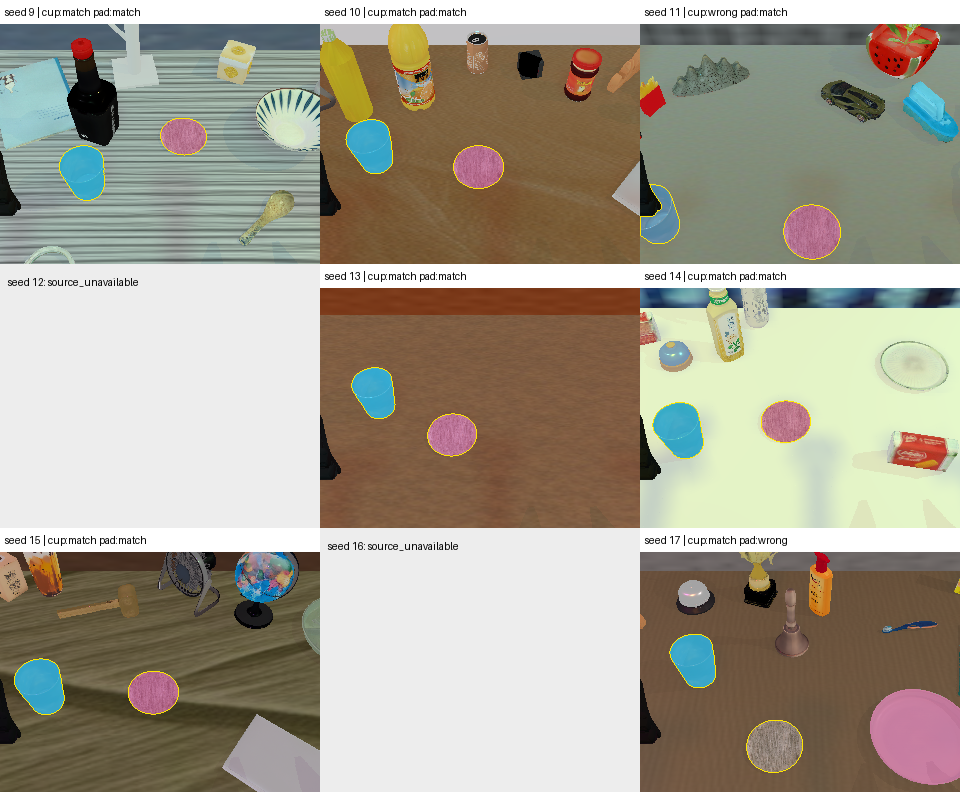

# ULA 阶段性汇报：杯子放置与微波炉开门

## 1. 实验设置

| 项目 | 设置 |
| --- | --- |
| 仿真平台 | RoboTwin |
| 测试任务 | `place_empty_cup`、`open_microwave` |
| 测试场景 | randomized：随机加入杂物、背景、光照和桌面高度变化 |
| 有效测试次数 | 每个任务 50 次 |
| 杯子任务执行方式 | 传统控制接近杯子，VLA 完成抓取，传统控制搬运并放到杯垫上 |
| 微波炉任务执行方式 | 传统控制接近把手，VLA 完成把手抓取，传统控制逐步拉开门 |
| 感知输入 | 头部和腕部相机提供的 RGB-D 图像 |
| 成功率统计 | 采用 RoboTwin 官方任务判定；场景建立前被 RoboTwin 拒绝的初始化样本不计入 50 次 |
| 时间统计 | 只统计 RoboTwin 官方判定成功的任务，并去掉第一个有效样本，避免首次模型加载影响平均时间 |

## 2. 最终实验结果

| 任务 | RoboTwin 官方成功次数 | RoboTwin 官方成功率 | 官方成功样本平均时间 |
| --- | ---: | ---: | ---: |
| `place_empty_cup` | **41/50** | **82%** | **8.525 s** |
| `open_microwave` | **36/50** | **72%** | **11.687 s** |

### 时间分解

下表统计 RoboTwin 官方判定成功的样本，并去掉第一个有效样本。表中的时间是每次任务在对应阶段的平均耗时。

| 阶段 | `place_empty_cup` | `open_microwave` |
| --- | ---: | ---: |
| 任务初始化 | 1.162 s | 0.363 s |
| 传统控制接近 | 1.724 s | 2.126 s |
| VLA 局部抓取 | 2.250 s | 0.467 s |
| 抓后视觉基准建立 | — | 0.062 s |
| 抓后传统控制：搬运放置／逐步开门 | 2.047 s | 7.663 s |
| 结果保存与评测 | 1.342 s | 1.006 s |
| **总时间** | **8.525 s** | **11.687 s** |

杯子任务中，传统控制只负责把夹爪送到杯子附近，最后几厘米的对准、下降和闭爪都由 VLA 完成。一次成功任务中，VLA 平均执行约 **33.6 个关节动作步**。这 2.250 s 不只是模型推理时间，其中约 0.473 s 用于模型生成动作，0.358 s 用于获取新图像，0.159 s 用于整理模型输入，0.358 s 用于把动作转换成平滑且可执行的短轨迹，另外约 0.896 s 用于机器人实际执行这些动作。因此，杯子任务的 VLA 阶段较长，是因为它需要一边观察、一边多次调整夹爪位置，最后再闭合夹爪。

微波炉任务在进入 VLA 阶段前，传统控制已经根据把手的三维位置，把夹爪送到非常靠近把手的位置。VLA 不需要再完成较长距离的对准，通常只生成一段包含 **8 个关节动作步**的闭爪动作，所以整个 VLA 阶段平均只有 0.467 s，其中模型推理约 0.112 s、动作执行约 0.129 s，其余时间用于观察、输入处理和轨迹平滑。

但是微波炉任务的总时间仍然比杯子任务长，主要原因不是 VLA，而是抓取后的传统开门过程。系统不是一次性把门拉到目标角度，而是每次只拉动约 3°，随后重新读取 RGB-D、拟合门板平面并估计当前门角，再规划下一小段运动。一次官方成功任务平均需要约 **27.2 次运动规划与执行、29.5 次门板观测**。因此，开门阶段平均耗时 7.663 s，其中路径规划约 3.195 s、机器人执行约 2.626 s、RGB-D 获取与门板几何计算约 1.238 s，其余约 0.604 s 用于控制和检查。

杯子任务在相同的前 42 个有效随机场景上，由 **76.2% 提高到 85.7%**；扩展到完整的 50 个有效随机场景后，RoboTwin 官方成功率为 **82%**。微波炉任务的 RoboTwin 官方成功率从早期随机场景的 **19.5% 提高到 72%**。

## 3. 最初的实验结果

| 任务 | 场景与方法 | RoboTwin 官方成功次数 | RoboTwin 官方成功率 |
| --- | --- | ---: | ---: |
| `place_empty_cup` | clean，纯传统控制 | 42/50 | 84% |
| `place_empty_cup` | clean，纯 VLA | 49/50 | 98% |
| `place_empty_cup` | clean，早期 ULA 已知模型方案 | 50/50 | 100% |
| `place_empty_cup` | randomized，早期 ULA | 32/42 | 76.2% |
| `open_microwave` | randomized，早期 ULA | 8/41 | 19.5% |

clean 场景证明了这种分工能够完成任务，但加入杂物、背景、光照和桌面高度变化以后，视觉观测和抓后控制暴露出明显问题。杯子任务的问题主要出现在试抬确认和搬运放置；微波炉任务的问题主要出现在把手识别、抓后门板跟踪和传统接近规划。

## 4. 两个任务最后采用的改进

| 执行阶段 | `place_empty_cup` | `open_microwave` |
| --- | --- | --- |
| 抓取前识别 | 从 RGB-D 图像中识别杯子和杯垫，利用深度得到三维位置，并用杯子三维模型辅助估计杯子位姿。 | 同时识别微波炉主体、门板和把手，利用深度估计门板平面、把手三维位置以及铰链方向。 |
| 传统接近 | 根据杯子的三维位置生成抓取前目标，传统规划器把夹爪移动到杯子附近。 | 根据把手位置和门板方向生成多组接近姿态，再结合机器人当前关节状态排序；先快速规划，全部失败后才进行完整规划。 |
| VLA 局部抓取 | VLA 负责最后几厘米的接近和闭爪。连续出现 3 个稳定闭爪动作后，直接交回传统控制。 | VLA 在把手附近完成最后一段接近和闭爪，避免传统控制直接处理复杂的把手接触。 |
| 抓取后的传统控制 | 先规划“搬运到杯垫上方”，再规划“向下放置”。两段都可行才执行，并搜索多个手腕偏航角和放置高度。 | 每次只把门拉开约 3°，随后重新观测门板、计算当前门角，再决定下一步动作，直到门打开。 |
| 观测异常处理 | 分割或点云不可信时重新识别目标，必要时改用腕部相机。有限次尝试后仍不可信就停止。 | 把手被遮挡后改为跟踪面积更大的门板；头部相机看不清时使用腕部相机。 |

### 杯子任务：取消额外试抬

早期版本在 VLA 闭爪后，还会把夹爪分三段向上抬高约 5 cm，再比较抓取前后的点云，判断杯子是否跟着夹爪移动。这个过程在杂乱场景中容易受到夹爪遮挡、杯身对称和深度缺失的影响：杯子可能已经抓住，但视觉匹配没有通过；试抬运动本身也可能规划失败。

最终版本取消了这一步。VLA 给出连续、稳定的闭爪动作后，传统控制直接开始搬运。这样少执行一次额外运动，也少了一个容易误判的视觉检查。对相同的前 42 个有效随机场景，成功次数由 **32/42 提高到 36/42**。

放置阶段也不再只尝试一个姿态。系统先规划搬运到杯垫上方，再规划垂直下降；同时搜索多个手腕方向和放置高度。如果某个姿态受到关节范围或障碍物限制，还可以继续尝试其他候选。

### 微波炉任务：跟踪门板，并加快传统接近

抓住把手以后，把手通常会被夹爪遮住，因此最终版本改为跟踪整块门板。系统从门板点云中估计门角，每拉动约 3° 就重新测量一次。门板观测不可靠时，依次尝试头部相机和腕部相机，不直接按照旧位置继续拉门。

早期传统接近会按固定顺序尝试多组姿态，每个姿态都运行一次完整路径规划，平均约 **13.37 s** 都花在路径计算上。最终版本先生成符合当前门板和把手几何关系的候选姿态，再根据机器人当前关节状态排序，并优先进行有时间上限的快速规划。传统接近阶段的平均时间由约 **14.34 s 降到 2.13 s**。

门打开后，视角变化可能使图像中的可见门板变小。原先固定的 8 cm 尺寸门槛会把真实门板误判为无效观测。最终版本取消了抓取后的固定尺寸限制，但仍检查有效深度点、平面拟合质量、运动方向和开门进度，因此不会在完全没有可靠观测时盲目拉门。

总体来看，杯子任务的改进重点是减少抓取后的多余检查和放置规划失败；微波炉任务的改进重点是让系统在门运动过程中持续看清门板，并降低传统接近阶段反复规划带来的时间开销。

## 5. 感知定位环节检查

这张图用于检查杯子任务开始时的感知定位环节。系统首先在 RGB 图像中找到杯子和杯垫：蓝色区域是识别出的杯子，粉色区域是识别出的杯垫，黄色线条表示分割边界。图像上方的文字给出人工核对结果：

- `cup:match`：识别出的杯子与任务目标一致。
- `cup:wrong`：杯子识别错误。
- `pad:match`：识别出的杯垫与任务目标一致。
- `pad:wrong`：杯垫识别错误。
- `source_unavailable`：该 seed 没有可用于这张汇总图的源图片，不能直接认为是感知失败。

这一步检查的是系统有没有在复杂背景中选对杯子和杯垫，属于抓取前感知定位的第一步。图中识别正确并不代表整个定位已经完成：系统随后还要读取这些区域对应的深度，将二维像素转换成三维点云，再转换到机器人坐标系，得到传统控制使用的杯子接近位置和杯垫放置位置。
