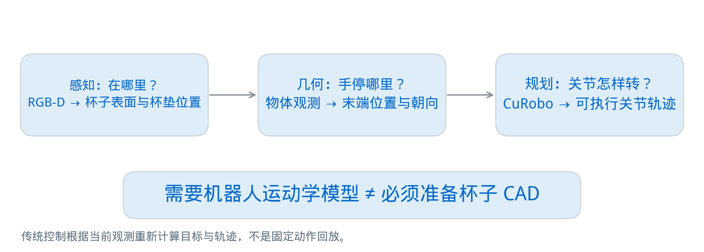
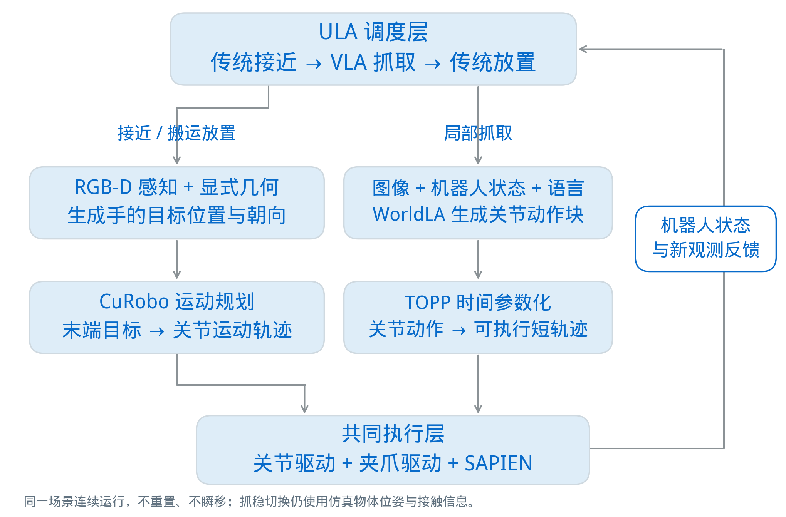
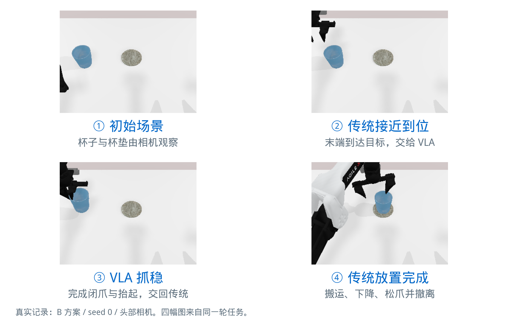
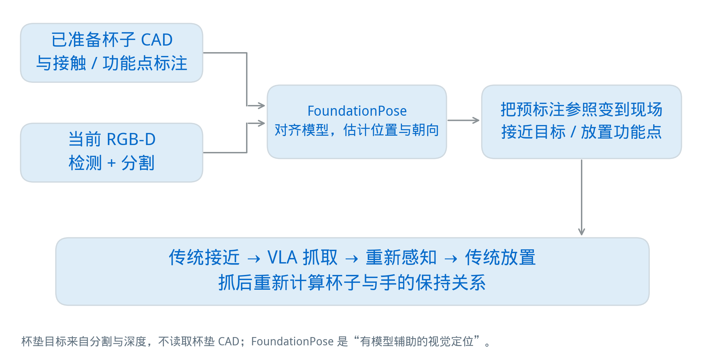
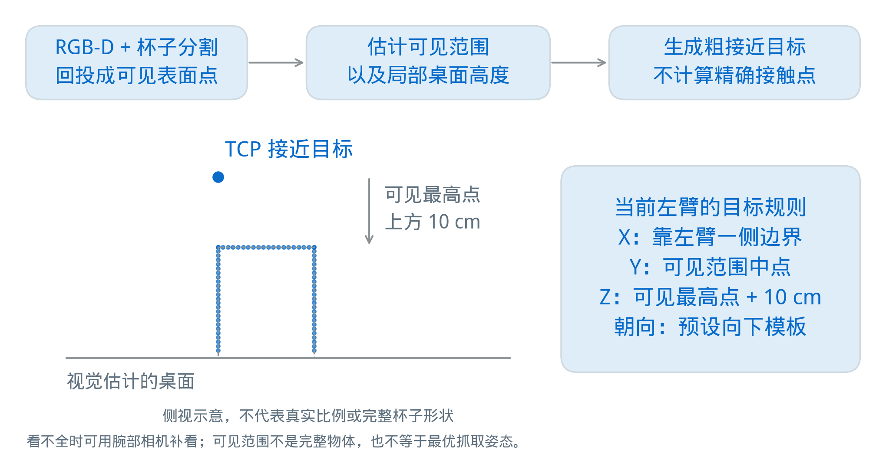
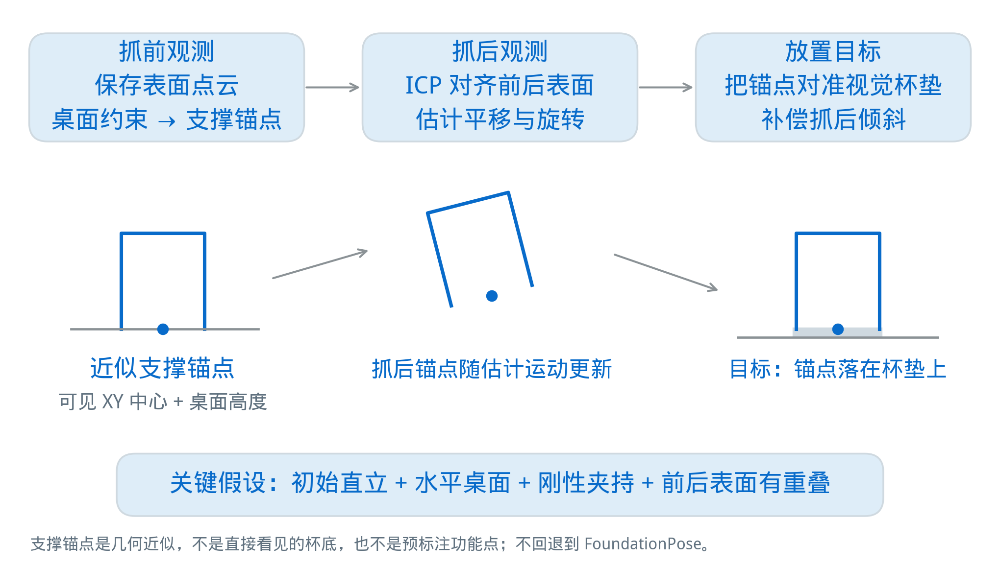
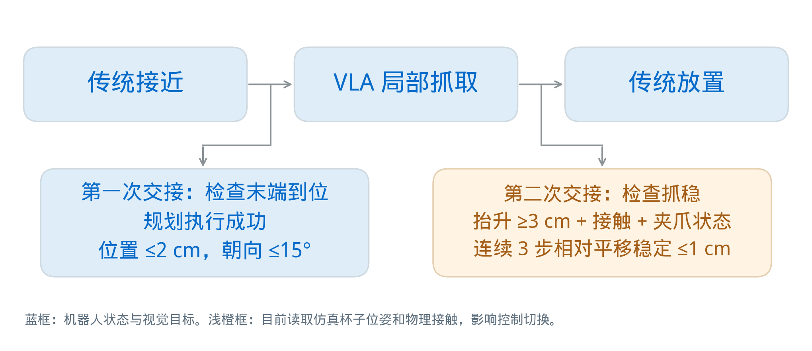
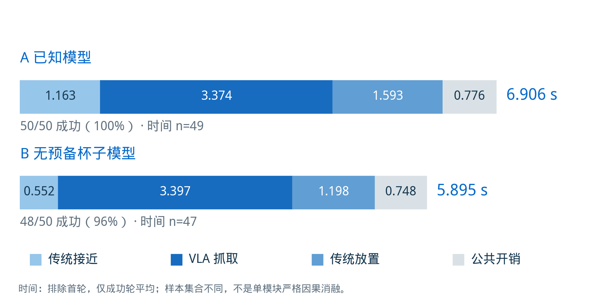
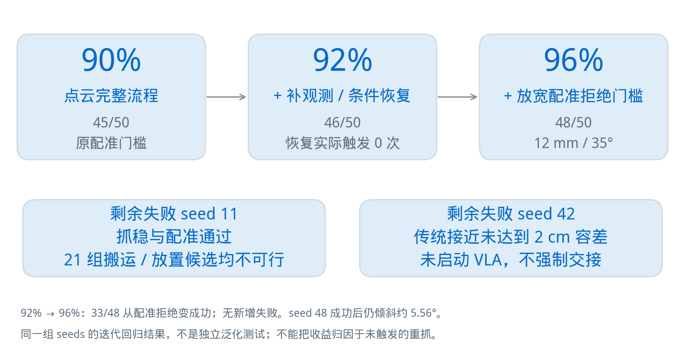
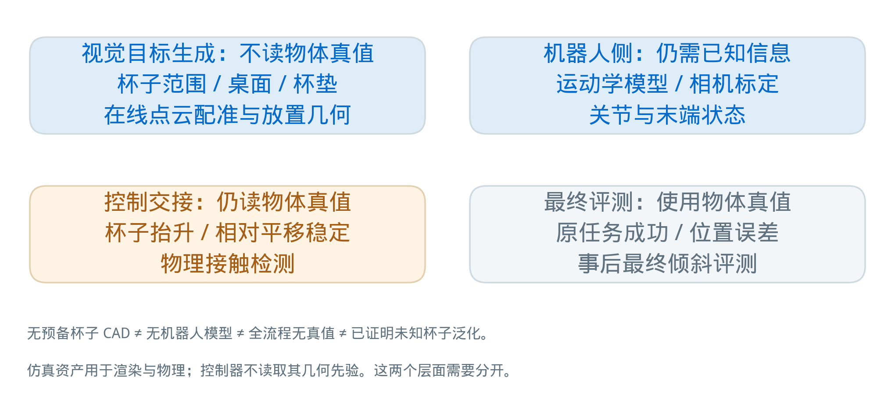

# ULA：让传统控制与 VLA 各做擅长的部分

组会图文汇报 · 2026 年 10 月 24 日 · 建议讲解 12–15 分钟

配套投屏版：[14 页 PDF](ula_group_meeting_report.pdf)；可编辑正文：[Word](ula_group_meeting_report.docx)。下列图均提供 PNG 与可编辑文字的 SVG，位于 [图表目录](figures/ula_group_meeting/)。

## 1. 我们现在要验证什么？

**不是重新训练一个包办全程的大模型，而是验证：同一次任务中，传统控制与现有 VLA 能否可靠地交接。**

以“把空杯子放到杯垫上”为最小任务：传统控制先把手送到杯子附近，VLA 完成最后接近、闭爪和抬起，抓稳后由传统控制负责搬运、放置、松爪和撤离。

当前得到两种实现：

| 方案 | 对杯子的事先准备 | 本批完整任务成功率 | 排除首轮后的成功轮平均完成时间 |
| --- | --- | ---: | ---: |
| A：已知模型辅助的融合方案 | 杯子 CAD、抓取接触点和放置功能点标注 | 50/50，100% | 6.906 s，49 个样本 |
| B：无预备杯子模型的融合方案 | 不读取杯子 CAD、尺寸、接触点或功能点标注 | 48/50，96% | 5.895 s，47 个样本 |

这里的“无预备模型”只针对**杯子几何先验**，不是说没有机器人模型或神经网络。B 的抓稳交接仍用仿真真值；两组都未验证未见杯子泛化。

**开场讲法：**“我们想让传统控制负责把手送过去和搬回来，让 VLA 负责中间最难写规则的抓取。当前先验证接力流程能不能跑通，以及不用杯子 CAD 后会损失什么。”

## 2. 先用通俗语言理解传统控制



传统控制不是“提前录好一段动作再播放”，而是根据这一次观测重新计算目标与轨迹：

1. **感知：看见什么、在哪里。** 检测杯子和杯垫，利用深度图计算三维位置。
2. **任务几何：手应该停在哪里。** 例如，接近时停在杯子一侧的上方；放置时让估计的杯底支撑位置对准杯垫。
3. **运动规划与执行：各关节怎样转。** CuRobo 把“手的目标位置与朝向”转成一条关节轨迹，执行器沿轨迹运动。

“末端（EE）”可理解为机器人手腕处的控制坐标系；“工具中心（TCP）”是夹爪工作位置，两者之间有固定的机器人运动学变换。不能把手腕位置直接当成指尖位置。

机器人模型用于回答“手能不能到、各关节怎样转”，杯子 CAD 用于回答“这个杯子的形状和标注在哪里”。**传统控制通常需要前者，但未必需要后者。**

## 3. 总体架构：三段接力，底层执行共用



ULA 调度层决定当前由谁控制。传统分支从 RGB-D 估计几何目标，再用 CuRobo 规划；VLA 分支从图像、机器人状态与语言生成关节动作块，经 TOPP 进行轨迹时间参数化，再交给执行层。

TOPP 可以理解为“为路径安排速度与时间”，不是另一个视觉模型，也不负责理解杯子位置。两条分支最终驱动同一套机器人关节与夹爪，在同一个 SAPIEN/RoboTwin 场景中运行。

**中途不重置环境、不瞬移杯子、不通过换场景完成交接。** 每次抓后重新观察，不能把抓前的杯子位置直接用于放置。

## 4. 一次真实任务如何完成？



图中为 B 方案 seed 0 的原始头部相机画面，依次是初始、传统接近到位、VLA 抓稳、传统放置完成。图片仅做排版组合，不是生成的示意场景。

| 阶段 | 谁控制 | 本阶段结束时要满足什么 |
| --- | --- | --- |
| 接近 | 传统控制 | 实际末端到达视觉生成的接近目标 |
| 局部抓取 | VLA | 杯子被抬起，并满足当前抓稳检测 |
| 搬运与放置 | 传统控制 | 先到杯垫上方，再下降、松爪、撤离 |

VLA 沿用已有整任务语言指令，并没有新训练一个专用抓取模型。它周期性重新看图、预测动作；外部抓稳监控一旦通过，就截断剩余动作，不让它继续包办放置。

## 5. 方案 A：有杯子模型，先“对齐已知形状”



“CAD”在这里指预先准备的三维杯子模型。FoundationPose 的工作可以理解成：**把已知杯子模型摆到与当前相机画面相匹配的位置和朝向。** 因此它不是凭一张图直接造出未知杯子的完整模型。

- GroundingDINO 找杯子和杯垫，SAM2 把对应像素分出来。
- FoundationPose 结合杯子模型与 RGB-D，估计杯子当前的位置和朝向。
- 接近时，把模型上预先标好的抓取接触坐标变换到当前场景，生成 pre-grasp 目标；真正闭爪抓取仍由 VLA 执行。
- 抓稳后重新估计杯子位姿，结合末端状态计算“杯子如何被夹在手里”；利用预标注的放置功能点对准视觉估计的杯垫。

本方案的 `pregrasp-distance=10 cm` 是**沿标注抓取方向的偏移**，不是“离杯子中心 10 cm 的球形区域”。

优点是几何参照明确；代价是需要提前准备杯子模型和相关标注，并付出模型配准的时间。当前元数据由资产提供，不能说是这套控制代码在运行时自动算出了标注。

## 6. 方案 B 的接近：没模型，就先量“眼前看见的范围”



“点云”可以理解成空间中的一堆测量点：分割得到杯子像素后，深度告诉我们每个像素离相机多远，再结合相机标定转成三维坐标。

当前接近方法不追求先求出精确抓取接触点，而是生成一个适合把剩余工作交给 VLA 的粗接近目标：

1. 从杯子掩码及深度提取表面点，进行边缘处理和异常值裁剪。
2. 从周围背景深度估计水平桌面高度，取杯子可见点的空间范围。
3. 当前固定左臂，取靠左臂一侧的 X 边界、Y 中点，以及“可见最高点上方 10 cm”作为 TCP 接近位置，采用预设向下朝向。
4. 根据 TCP 与 EE 的机器人变换求手腕目标，再由 CuRobo 规划。

**这只是可见表面的范围，不是完整杯子重建。** 预设朝向也不是从点云识别出的最佳抓取姿态。

当杯子在头部图像边缘被截断时，会在初步接近后用当前手腕相机补看；必要时最多做一次保持朝向的居中移动并重看。补观测用于改善范围估计，不是随意拼出完整杯子。当前保留头部抓前点云作为之后配准的参考。

## 7. 方案 B 的放置：追踪杯子“从刚才到现在怎么动了”



杯底被桌面挡住，看不见怎么办？当前利用一个明确假设：**杯子最初直立、静止放在水平桌面上。** 由此定义近似支撑锚点：

```text
抓前支撑锚点 = [可见范围的 X 中心，可见范围的 Y 中心，视觉桌面高度]
```

这个点不一定是精确杯底中心，不能当作真实重建出的隐藏底面。把手、遮挡和可见范围不对称都可能使它有偏差。

抓稳后再采集头部 RGB-D，把抓后点云与本轮抓前点云配准。ICP 的直观过程是：给两堆点寻找对应关系，反复尝试平移和旋转，让重叠表面尽量贴合。它回答的是“杯子相对刚才移动了多少”，而非“在某个已知 CAD 坐标系中的精确位姿”。

配准得到的运动用于更新支撑锚点；结合当前末端状态，在刚性夹持假设下计算手应怎样移动，使锚点落到视觉杯垫中心，同时补偿估计倾斜，恢复抓前假定的直立方向。释放目标留 3 mm 间隙。

放置前最多尝试 7 个偏航方向 × 3 个上方高度，共 21 组候选。**先把搬运与下降两段都规划成功，才执行；两段均检查到位后才松爪。** 失败候选不实际执行，也不会失败后偷偷回退到 FoundationPose。

ICP 的低误差不保证姿态一定正确：杯子对称、表面遮挡、夹爪点混入都可能让两堆点“贴得上，但解释错了”。

## 8. 谁来决定什么时候交接？如何避免反复加载？



第一次交接不判断“到杯子多少厘米”，而是检查是否到达**视觉生成的目标末端位姿**：规划和执行成功，实际 EE 位置误差 ≤2 cm、朝向误差 ≤15°。失败就停止，不强行启动 VLA。

第二次交接要求：杯子抬升 ≥3 cm、夹爪与杯子存在接触、夹爪归一化开度 <0.6，并连续 3 个动作保持杯子相对末端的平移变化 ≤1 cm。当前这一步直接使用仿真的杯子位姿和物理接触，**是控制切换中的真值依赖，不只是事后评分**。

为了避免每一段都重新加载模型，VLA 与视觉模型各自常驻：VLA 在 Python 3.11 中运行，视觉在独立 Python 3.10 进程中运行；每次仍处理新图像，而不是复用旧位置。每轮清空 VLA 的观测与动作缓存，但保留模型权重。

B 方案本批视觉进程只启动一次，共处理 109 个新帧请求；首轮 61.221 s 包含加载和预热，因此稳态统计不包含它。A 的首轮为 71.491 s。下文的秒数是主机墙钟耗时，不等于实机运动时间。

## 9. 实验设置：这 50 次到底测了什么？

| 项目 | 设置 |
| --- | --- |
| 仿真任务 | RoboTwin / `place_empty_cup` / `demo_clean` |
| 机器人与场景 | aloha-agilex；固定左臂及对应侧采样；默认光栅渲染 |
| 样本 | 同一杯子资产，seeds 0–49 的不同初始摆放；不是 50 种杯子 |
| VLA | 原 WorldLA 100000 步 checkpoint，未为融合重新训练 |
| VLA 输入 | 头部、双腕 RGB；机器人关节状态；语言指令 |
| 语言 | “Place the empty blue cup on the round coaster.” |
| 推理 | `tail_blend=0.25`；推理 seed 20260901；动作块最多 10 步 |
| 预算 | 每轮 VLA 总预算 500 个动作；B 允许至多一次条件抓取恢复 |
| B 的补观测 | 启用 `pointcloud-multiview`，本批 5 轮触发 |
| B 的配准门槛 | RMSE ≤12 mm、估计相对倾斜 ≤35°；原默认 8 mm / 25° 不变 |
| 硬件 | 日志中的 NVIDIA A100-SXM4-80GB，GPU 5；模型在批次内常驻 |

成功沿用原任务标准：杯子/杯垫功能点水平距离 <3.5 cm、高度差 <1.5 cm，且双夹爪打开。**原标准不检查精确直立角度。**

统计口径：成功率包含所有 50 轮；完成时间排除第一轮，并只平均成功轮次。计时从该轮环境建立到最终评测与阶段截图完成；包括感知、规划、动作执行和公共开销，但不含批次前导入、轮末环境关闭和最终汇总写盘。

## 10. 主结果：省时主要发生在传统两段，VLA 基本不变



| 平均耗时，秒 | A：已知模型辅助 | B：无预备杯子模型 |
| --- | ---: | ---: |
| 传统接近 | 1.163 | 0.552 |
| VLA 局部抓取 | 3.374 | 3.397 |
| 传统搬运放置 | 1.593 | 1.198 |
| 环境建立、截图、评测等公共开销 | 0.776 | 0.748 |
| 合计 | 6.906 | 5.895 |
| 上述均值样本数 | 49 | 47 |

这两个完成时间均值相差约 1.010 s（相对 A 约 14.6%）。VLA 基本相同，差异主要出现在传统感知和几何处理：A 两次 FoundationPose 合计约 1.249 s；B 不加载它，但新增在线点云配准等计算。

**注意解释边界：**两组成功样本集合不同，而且 B 同时更换了接近/放置几何、加入补观测、设置不同的配准门槛。因此不能把这 14.6% 当成单独删除 FoundationPose 的严格因果增益，也不能据此证明融合比纯传统或纯 VLA 更快。当前没有统一条件下的纯方法完整对照。

## 11. B 方案内部耗时：模型推理不是最大头

以下均为 B 排除首轮后的 47 个成功样本，采用互不重叠的计时项。

| 传统部分分项，秒 | 接近 | 放置 |
| --- | ---: | ---: |
| RGB-D / 状态获取 | 0.014 | 0.011 |
| 检测、分割与视觉几何端到端调用 | 0.144 | 0.150 |
| 抓前/抓后点云配准 | — | 0.256 |
| 运动规划，含候选搜索 | 0.094 | 0.299 |
| 轨迹与夹爪执行 | 0.260 | 0.480 |
| 目标生成、补观测调度等余量 | 0.041 | 0.002 |
| 合计 | 0.552 | 1.198 |

| VLA 分项 | 平均耗时，秒 |
| --- | ---: |
| 图像和机器人状态获取 | 0.303 |
| 输入预处理 | 0.074 |
| 模型采样、同步回传与推理调度 | 0.492 |
| TOPP 轨迹时间参数化 | 0.547 |
| 关节动作执行、仿真推进等 | 1.952 |
| 观测组装、后处理、监控与其余调度 | 0.028 |
| 合计 | 3.397 |

TOPP 加动作执行约占 VLA 阶段 73.6%；只压缩神经网络推理并不能消除大部分当前耗时。它也不是纯 GPU 算子性能测试：模型计时包含采样和回传，动作计时受仿真与控制接口影响。四舍五入可能产生 1 ms 级加总差异。

## 12. 从 90% 到 96%：改善了什么，没改善什么？



| 完整 50 轮版本 | 成功 | 观察与改变 |
| --- | ---: | --- |
| 点云完整流程，原门槛 | 45/50，90% | 18/47 抓稳超时；33/48 配准拒绝；42 接近未到位 |
| 加补观测与条件抓取恢复，原门槛 | 46/50，92% | 18/47 成功；11 新出现放置规划失败；33/42/48 仍失败 |
| 保留上项，RMSE/倾斜门槛放宽 | 48/50，96% | 33/48 获准并完成；11/42 仍失败；相对上一批无新增失败 |

“92% → 96%”这一步唯一控制参数改变是 RMSE 8→12 mm、估计相对倾斜 25→35°；ICP 优化算法、重叠门槛、末端到位与原任务成功标准都没放宽。seed 33 的所选 RMSE 为 10.201 mm；seed 48 的估计相对倾斜为 26.344°。本批这两轮的其他配准候选也均不满足旧门槛。

这里的 35° 指**抓前到抓后的估计刚体运动倾斜上限**，不是允许最终杯子倾斜 35°。seed 48 完成原任务后，事后真值评测仍发现最终倾斜约 5.56°；因此 96% 不能解释成全部精确直立放置。

当前剩余失败：

- **seed 11：**抓取与配准通过，但 21 组候选都无法形成可行的搬运/下降轨迹对；属于可达性/规划问题，不是这次配准门槛的问题。
- **seed 42：**传统接近末端误差超出 2 cm，未启动 VLA；完整点云旧批中为约 5.54 cm。不强制交接仍计失败，具体感知误差成因还需独立核查。

补观测在后两批各触发 5 轮；**条件抓取恢复没有一次实际触发，不能把成功率提升归因于重抓机制。** A 中的 6 轮“换候选后成功”同样是执行前的规划搜索，不是掉落后重抓。

这些是同一组 seeds 的迭代回归结果，不是独立测试集结论；单个 seed 的抓后状态和配准也可能在重跑时变化。

## 13. 哪些地方还用了真值？哪些能力还没有证明？



| 环节 | 当前 B 的信息来源 | 是否使用物体仿真真值 |
| --- | --- | --- |
| 杯子范围、桌面高度、杯垫目标 | RGB-D、检测、分割、相机标定 | 否 |
| 抓后运动和放置目标 | 在线参考点云、ICP、机器人末端状态 | 否 |
| 抓稳交接 | 杯子仿真位姿、夹爪开度、物理接触信息 | **是，影响控制切换** |
| 最终成功、位置误差、最终倾斜 | 仿真任务判定和物体状态 | 是，事后评测 |

仿真仍要加载杯子与杯垫资产来生成图像和物理现象；这不等于控制器读取其 CAD 作为输入。机器人模型、相机标定和状态仍然已知，规划器也保留原机器人与已知桌面的碰撞配置。

当前不能宣称：全流程无真值、对任意未知杯子泛化、严格直立/力控放置、未知障碍安全避障，或已达到实机可部署。点云方法依赖初始直立、水平支撑、刚性夹持与足够可见重叠；当前没有在线更新夹持物/未知障碍碰撞模型。

## 14. 结论与下一步

**已经完成：**同一仿真场景中实现“传统接近 → VLA 抓取 → 传统放置”的两次交接；模型常驻后获得可分解的稳态计时；在不读取预备杯子几何的条件下完成 48/50 次完整任务。

**当前取舍：**已知模型路线几何参照更明确，本批 100%；无预备模型路线准备成本更低、成功轮平均时间更短，本批 96%，但对可见范围与表面配准更敏感。

建议下一步按三件事推进：

1. **先解决剩余失败。** 核查 seed 42 的范围估计与目标生成；对 seed 11 研究到位前可达性判断、候选生成和抓后可达空间，不能仅靠继续放宽 ICP。
2. **再提高放置质量与交接真实性。** 增加视觉末段修正和独立直立角度指标，研究视觉/力觉抓稳检测，替代控制切换中的物体真值。
3. **最后检验泛化与公平对照。** 冻结参数后，在新 seeds、新杯子和更复杂遮挡上测试；补充同条件纯传统、纯 VLA、融合方案及开关消融，报告重复试验波动。

建议组会讨论的问题：当前研究重点是“弱几何先验下的可靠交接”，还是“融合策略的性能优势”？前者需要补强抓稳与不确定性估计，后者必须补齐严格统一的基线实验。

## 附录：结果出处、实现与复现

本报告不启动新实验，不覆盖已有结果；数值来自已完成批次。

- A 主结果：[原始报告](../results/three_stage_50eps_seed0_profiled/report.json)、[设计与分项计时](ula_design_and_experiments.md)。
- B 最新主结果：[原始报告](../results/pointcloud_relaxed_12mm_35deg_50eps_seed0_gpu5_v1/report.json)、[完整总结](../results/pointcloud_relaxed_12mm_35deg_50eps_seed0_gpu5_v1/SUMMARY.md)、[冻结配置](../results/pointcloud_relaxed_12mm_35deg_50eps_seed0_gpu5_v1/EXPERIMENT.md)。
- 90% 版本：[原始报告](../results/pointcloud_full_50eps_20261024_190030/report.json)。
- 92% 版本：[原始报告](../results/pointcloud_mv_retry_50eps_seed0_gpu5_v1/report.json)。
- 算法：[点云接近](pointcloud_approach.md)、[点云放置](pointcloud_placement.md)、[补观测与条件恢复](multiview_grasp_retry.md)、[配准门槛对照](registration_quality_ablation.md)。部分早期文档保留当时的 10 轮阶段性结果；本报告以以上 50 轮批次为准。
- 代码入口：[运行调度](../scripts/run_place_empty_cup.py)、[点云几何](../adapters/pointcloud_geometry.py)、[配准](../adapters/pointcloud_registration.py)、[放置目标](../adapters/pointcloud_placement.py)、[抓稳判定](../adapters/grasp.py)。

复现 B 的设置（仅为命令示例，先检查 GPU 空闲，使用新的输出目录）：

```bash
cd /data1/xuhuixin/ula
GPU=5 bash scripts/run_place_empty_cup.sh \
  --mode hybrid --approach-mode pointcloud \
  --pointcloud-multiview --grasp-retries 1 --grasp-stall-steps 120 \
  --registration-max-rmse 0.012 --registration-max-tilt 35 \
  --episodes 50 --seed 0 --max-vla-steps 500 \
  --output /data1/xuhuixin/ula/results/pointcloud_group_meeting_repeat
```

重新生成投屏版及图表（不需要 GPU）：

```bash
cd /data1/xuhuixin/ula
MPLCONFIGDIR=/tmp/ula_report_mpl \
  external/pi05/.venv/bin/python scripts/build_group_meeting_report.py
```
